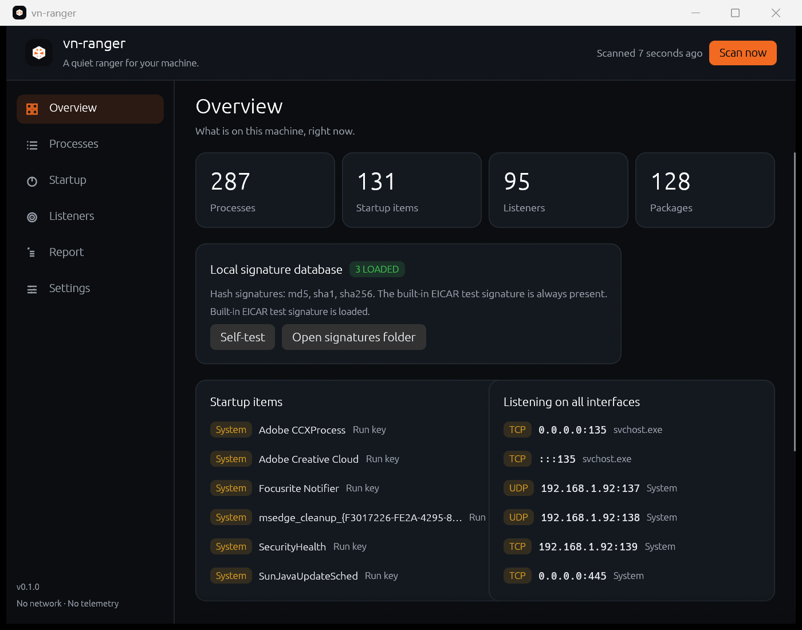

<div align="center">

<picture>
  <source media="(prefers-color-scheme: dark)" srcset="assets/logo/vn-ranger-white-512.png">
  
</picture>

# vn-ranger

**A quiet ranger for your machine.**

[](LICENSE)
[](#build)
[](#build)
[](https://github.com/emilk/egui)
[](docs/PLAN.md#7-platform-matrix)
[](docs/PLAN.md#13-privacy-and-data)

</div>

<p align="center">
  
</p>

<p align="center"><sub>v0.1.0 · read-only inventory · local hash signatures · opt-in administrator scan</sub></p>

## What it is for

- **See.** Processes and their ancestry, what starts on its own, what is listening,
  what is installed — and the agents, MCP servers and local model runners that now sit
  in that list.
- **Explain.** Every finding carries its subject, the observation that produced it, the
  rule that fired, and what the finding does *not* mean. No score without a reason.
- **Remember.** A baseline of what was true on a good day. Later checks report the
  difference, not a vague "threat found".
- **Act.** Quarantine and cleanup arrive in v0.3.0: previewed first, journalled,
  reversible. Never in the background, never silently.

## What it will never do

- **No telemetry, no account, no network.** The binary links no HTTP client at all,
  and CI fails if one appears in the dependency tree. Nothing about the machine leaves
  it.
- **No silent privilege, no kernel driver, no hidden service.** Ranger runs as you. An
  administrator scan is a separate, one-shot copy that the operating system asks you
  to approve; it writes one report and exits. There is no service and no standing
  administrator process.
- **No silent deletion, no registry cleaning, no "boost".** Every action is previewed
  and reversible; the snake-oil half of this category is out of scope on purpose.
- **No paywall, no ads, no upsell.** MIT, free forever.

## Build

The workspace uses the same commands as vn-launcher:

```bash
cargo run --release              # build and run the ranger
cargo build --release            # build it without running it

cargo run --release -- --report report.json   # scan without a window

cargo xtask ci                   # formatting, lints and tests — exactly what CI runs
cargo xtask fmt-fix              # apply formatting
cargo xtask lint                 # clippy over the workspace, warnings denied
cargo xtask test                 # the test suite
```

v0.1.0 is a read-only inventory. It collects processes, startup items, listening
sockets and installed packages, loads ClamAV-format `.hdb` / `.hsb` hash databases
from the data directory, and can ask Windows for one administrator scan. It does not
quarantine, clean or modify anything yet.

## Documentation

| Document | What it answers |
|---|---|
| [docs/PLAN.md](docs/PLAN.md) | The research, the scope, the architecture and the roadmap |
| [docs/RELEASES.md](docs/RELEASES.md) | The release contract that makes ranger installable by vn-launcher |
| [SECURITY.md](SECURITY.md) | What ranger protects, what it cannot, and how to report a flaw |
| [AGENTS.md](AGENTS.md) | The rules a change to this repository has to keep |
| [assets/logo/README.md](assets/logo/README.md) | The mark and every file in the set |
| [assets/logo/BRAND.md](assets/logo/BRAND.md) | Construction, clear space, contrast and usage |

## Licence

MIT — see [LICENSE](LICENSE). The mark is original vecnode work.
