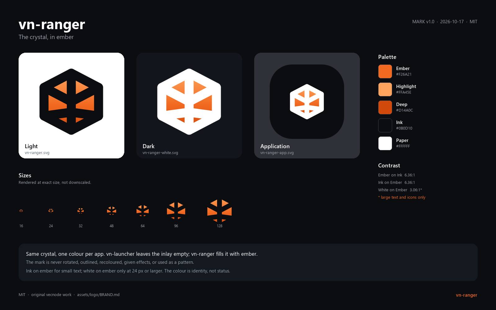

# The vn-ranger mark

A girdled crystal, shared with every application in the vecnode/vn suite. The lines are
vn-launcher's; the colour inside is ranger's.

The suite keeps one mark and changes one thing per application: the **inlay**, the
colour that fills the facets. vn-launcher leaves it transparent. vn-ranger fills it
with ember.

This file is the quick guide. [`BRAND.md`](BRAND.md) is the design record —
construction, clear space, minimum sizes, contrast and usage rules. [`MANIFEST.toml`](MANIFEST.toml)
is the machine-readable one: every palette value and the SHA-256 of every file here.

## Geometry

The mark lives on the same 24-unit grid as vn-launcher, so the two cannot drift apart:

- a hexagon with vertices at `(12,2.8) (20.8,7.4) (20.8,16.6) (12,21.2) (3.2,16.6) (3.2,7.4)`;
- a crown ridge `(3.2,7.4) → (12,12) → (20.8,7.4)`;
- a spine `(12,2.8) → (12,21.2)`;
- a girdle `(12,15.4) → (3.2,16.6)` and `(12,15.4) → (20.8,16.6)`;
- a stroke of `2.914` units, round caps and round joins.

Every endpoint sits on a hexagon vertex or on the spine, which is what keeps the
facets meeting cleanly instead of crossing. The inlay is a single hexagon fill under
the linework, so the ridges stay crisp and the facets read as one crystal rather than
six coloured tiles.

## The ember

| Token | Value | Use |
|---|---|---|
| Ember highlight | `#FFA45E` | Top of the inlay gradient |
| Ember | `#F26A21` | The suite colour; the launcher catalogue, badges |
| Ember deep | `#D14A0C` | Bottom of the inlay gradient |
| Ink | `#0B0D10` | Linework on light backgrounds; the application tile |
| Paper | `#FFFFFF` | Linework on dark backgrounds |

The gradient is vertical, `#FFA45E → #F26A21` at 55% `→ #D14A0C`, so the crown catches
the light and the base sits deeper. Orange was chosen because it reads as attention
without reading as alarm, and because it is unmistakably not the launcher's uncoloured
crystal.

Ink on ember is 6.36:1 and is the pair used for small text. White on ember is 3.06:1
and is only for large text and icons. [`BRAND.md`](BRAND.md) has the full table.

## Which file to use

| Family | For |
|---|---|
| `vn-ranger.svg`, `vn-ranger-<size>.png` | Light backgrounds. Ink linework, ember inlay, transparent elsewhere. |
| `vn-ranger-white.svg`, `vn-ranger-white-<size>.png` | Dark backgrounds. White linework, ember inlay, transparent elsewhere. |
| `vn-ranger-app.svg`, `vn-ranger-app-<size>.png` | An application icon: the mark on the suite's black tile, with white ridges. |
| `vn-ranger-app.rgba` | 64×64 unmultiplied RGBA for `egui::IconData`, embedded with `include_bytes!`. |

## Sizes

16, 24, 32, 48, 64, 128, 256, 512 and 1024 pixels square.

**Prefer the SVG** wherever the target accepts it. It scales without resampling and is
the only file here that belongs in a print job or a store listing. The PNGs exist
because most places still want one.

Each PNG was rendered at its exact size from the SVG, not downscaled from a master.
That matters most at the bottom of the range, where resampling a 1024 down to 16 turns
a 2.9-unit stroke into a grey smear.

## Below about 32 pixels

The faceting costs legibility as the size drops. At 16 pixels the bare mark reads as a
dark hexagonal blob with ember notches — about as much as any six-line mark can say at
that size. Where a 16-pixel icon has to be recognisable, use `vn-ranger-app-16.png`:
the tile gives the eye a solid silhouette to hold on to, and the ember gives it a
colour to find.

## The application icon

`vn-ranger-app.rgba` is 64×64 unmultiplied RGBA, exactly the three fields
`egui::IconData` takes. `apps/vn-ranger/src/main.rs` embeds it with `include_bytes!`,
so putting an icon on the window and the taskbar costs the application no image
decoder.

The application tile is 1024 × 1024 with a **308 px** corner radius; the crystal is
scaled **22.73×** and translated **239.25 px** so its visible bounds are about
468 × 486 px, centred. The tile is the suite's black, not the ember. An icon has to
hold its own against whatever is behind it: a bare black glyph disappears on a dark
taskbar and a bare white one on a light taskbar, whereas a black tile with a white
crystal and an ember inlay reads on both.

## The suite rule

**Same crystal, one colour per application, no other variants.** The mark is a suite
identifier, not a per-project illustration. A new vecnode/vn application gets the same
geometry and a new inlay colour; it does not get a new shape, a rotation, an outline
variant or a gradient in a different direction.

## Regenerating

The SVGs are the source of truth. The PNGs and the `.rgba` are generated:

1. Render each SVG at the exact pixel size (a browser in headless mode, `resvg`, or
   any SVG rasteriser) onto a transparent canvas.
2. For the application tile, keep the black rounded square; only the corners are
   transparent.
3. Decode `vn-ranger-app-64.png` to unmultiplied RGBA and write the 16,384 raw bytes to
   `vn-ranger-app.rgba`.
4. Regenerate `contact-sheet.png` and `MANIFEST.toml`, and keep the mark in step with
   `crates/ui/src/lib.rs`; this directory is the distribution copy, not the drawing
   code.

A future `cargo xtask logo` will do this, so the set is reproducible rather than
hand-maintained. Until then, the geometry in [`BRAND.md`](BRAND.md) and the SVGs are
enough to regenerate it exactly.

## Licence

MIT, like the rest of the repository. The mark is original vecnode work and contains no
third-party asset.
